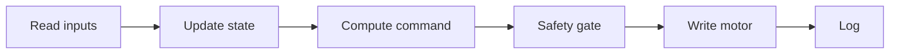

# Kestrel

A friction-drive e-bike conversion controlled by a Raspberry Pi running CTRE Phoenix 6 in C++.

## Overview

Kestrel drives a single FRC Falcon 500 (integrated Talon FX) against the rear tire of an ordinary bicycle through a friction roller. A Raspberry Pi commands the motor over CAN using the Phoenix 6 C++ API on plain Linux, with no roboRIO.

## How it works

### Hardware

| Part | Choice |
| --- | --- |
| Motor and controller | FRC Falcon 500 (integrated Talon FX) |
| Drive | Friction roller on the rear tire |
| Computer | Raspberry Pi (64-bit OS) |
| CAN interface | CANable USB adapter, via SocketCAN |
| Motor library | CTRE Phoenix 6, C++ (non-FRC Linux) |
| Rider inputs | Throttle, brake switch, cadence sensor |

### Control loop

`main` runs a fixed-rate loop with a 20 ms period. Each iteration runs this pipeline:



- **State** is one of `Boot`, `Ready`, `Assist` or `Fault`.
- **The safety gate always runs last**, so nothing reaches the motor without passing through it. It applies: brake cutoff, fault cutoff, a power cap (under 750 W), and a speed cap (15 mph in NYC, 20 mph elsewhere).
- **Watchdog:** Phoenix 6 outside FRC only drives a motor while the program keeps feeding its enable signal. The loop feeds it every iteration, so if the program hangs or crashes the motor goes neutral when the enable times out.

`ControlLoop` handles the timing: it passes the measured time since the previous iteration to the tick function, counts and reports overruns, and returns on `SIGINT` or `SIGTERM` so the motor can be commanded to neutral before exit.

The logic is split so it can be tested without the bike. `src/core` holds the state machine and safety gate as pure functions of their inputs with no hardware access or clock reads, and builds as the `kestrel_core` library with no dependency on Phoenix. `src/hw` wraps Phoenix 6 and the sensors.

## Repo structure

```
src/
  main.cpp          entry point; runs the control loop
  ControlLoop.*     fixed-rate loop: timing, overrun reporting, clean shutdown
  Config.hpp        tunable constants: CAN IDs, pins, gearing, limits
  Logger.*          per-iteration logging
  core/             pure logic, built as kestrel_core
    Types.hpp       InputState, MotorState, Command
    Controller.*    state machine and assist logic
    Safety.*        safety gate
  hw/               hardware access
    Inputs.*        throttle, brake, cadence
    Motor.*         Talon FX wrapper
tests/              GoogleTest unit tests for kestrel_core
Dockerfile          dev, build and runtime images (Debian Bookworm, arm64)
.devcontainer/      dev container definition
build.sh            one-shot build inside the dev image, run from the host
compose.yaml        runs the runtime image on the Pi
generic_socketcan_start.sh   brings up a SocketCAN interface
```

Source files are globbed by CMake with `CONFIGURE_DEPENDS`, so adding or removing a `.cpp` needs no `CMakeLists.txt` edit.

## Building

Phoenix 6 for non-FRC targets is Linux-only, so development on macOS happens in an arm64 Debian Bookworm container that matches the Pi. The container is for compiling, IntelliSense and unit tests only. It cannot reach the CAN adapter; anything involving hardware runs on the Pi.

### Dev container

1. Start Docker.
2. Open the repo in Zed (or any editor with dev container support) and reopen it in the dev container.

The container is the `dev` stage of the `Dockerfile` (compiler, CMake, GoogleTest, clangd, gdb). On creation it runs the CMake configure step, which writes `build/compile_commands.json` for clangd.

### Configure, build, test

Inside the container:

```sh
cmake -S . -B build -DCMAKE_BUILD_TYPE=Debug   # only needed once, or after deleting build/
cmake --build build -j
ctest --test-dir build
```

This builds three targets: `kestrel_core` (library), `Kestrel` (the program) and `kestrel_tests`.

From the host, `./build.sh [Debug|Release]` does the configure and build steps in the same image and the same `build/` directory.

CI (`.github/workflows/build.yml`) builds the `runtime` image on an arm64 runner on every push. That image build compiles in Release and runs the unit tests.

### Raspberry Pi setup

Install Phoenix 6 from CTR Electronics' APT repository, plus the build tools:

```sh
sudo curl -s --compressed -o /usr/share/keyrings/ctr-pubkey.gpg "https://deb.ctr-electronics.com/ctr-pubkey.gpg"
sudo curl -s --compressed -o /etc/apt/sources.list.d/ctr2026.list "https://deb.ctr-electronics.com/ctr2026.list"
sudo apt update
sudo apt install phoenix6 cmake build-essential libgtest-dev
```

Build:

```sh
cmake -S . -B build -DCMAKE_BUILD_TYPE=Release
cmake --build build -j
```

Bring up the CAN interface, then run. With a generic SocketCAN adapter such as the CANable, the interface has to be started manually (1 Mbit/s, `can0` by default):

```sh
./generic_socketcan_start.sh        # or: ./generic_socketcan_start.sh can1
./build/Kestrel
```

See the [Phoenix 6 non-FRC installation guide](https://v6.docs.ctr-electronics.com/en/stable/docs/installation/installation-nonfrc.html) for system requirements.

## Roadmap

- [ ] Pedal assist via cadence sensor
- [ ] Physics-based auto-assist (IMU grade + speed)
- [ ] GPS speed-cap geofencing
- [ ] Ride logging
- [ ] LiFePO4 battery upgrade
- [ ] Optional planetary gearbox and larger roller

## Safety and legal

This is an experimental, home-built vehicle project, not a tested or certified design. Build or ride anything based on it at your own risk.

Nothing in this repo is legal advice. The limits Kestrel is designed around come from New York e-bike rules as the author understands them: motor power under 750 W, and a 15 mph speed cap in New York City. Check the current law where you ride.

## Credits

Based on [CrossTheRoadElec/Phoenix6-Linux-Example](https://github.com/CrossTheRoadElec/Phoenix6-Linux-Example).
